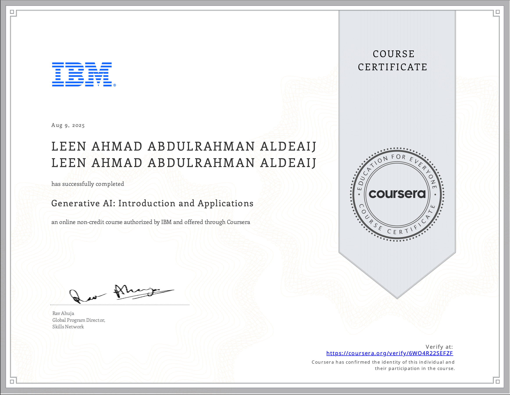

# 🤖 Generative AI: Introduction and Applications

I successfully completed **Generative AI: Introduction and Applications**, an online non-credit course authorized by IBM and offered through Coursera.

This course introduced me to the fundamentals of Generative AI, its real-world applications, and its role in transforming different industries.

- **Provider:** IBM
- **Platform:** Coursera
- **Field:** Artificial Intelligence

---

## 🏆 Certificate

